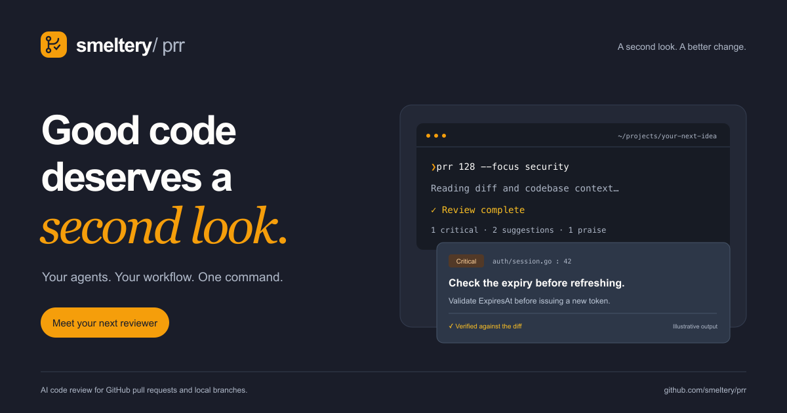

<p align="center"></p>

# prr

**A second look. A better change.** AI code reviews for GitHub pull requests and local branches, right in your terminal.



[](https://github.com/smeltery/prr/actions/workflows/ci.yml)
[](https://github.com/smeltery/prr/releases)
[](LICENSE)
[](go.mod)
[](package.json)
[](website/)
[](.flox/env/manifest.toml)
[](docs/installation.md)

prr gathers the diff and surrounding code, asks your chosen agent for a review, verifies the findings, and writes readable Markdown organized by severity. Use Claude or Codex CLI sessions, or connect Anthropic and OpenAI APIs. Browse results locally and post to GitHub when you're ready.

## Get started

```sh
go install github.com/smeltery/prr@latest
prr agents
prr                                      # Current branch's PR
prr https://github.com/owner/repo/pull/123
prr --base main                          # Local branch review
prr serve --open                         # Browse saved reviews
```

PR reviews require an authenticated [GitHub CLI](https://cli.github.com/). Configure an [agent](docs/agents.md) first; `claude-cli` is the default. Review data is sent to the selected provider. Nothing is posted automatically.

## Documentation

Start with [docs/](docs/README.md): [installation](docs/installation.md), [reviewing changes](docs/reviews.md), [configuration](docs/configuration.md), [output](docs/output.md), and the [command reference](docs/commands.md). The website renders these same Markdown files.

## Develop

```sh
flox activate
make setup          # Locked Bun dependencies and Git hooks
make ci             # Shared checks, race tests and builds
```

Run `flox activate --start-services` for the website at `http://localhost:3004`. See [development](docs/development.md) for CI, release automation, Mermaid validation and LOC budgets.

[PolyForm Shield License 1.0.0](LICENSE) · [Credits](THIRD_PARTY_LICENSES.md)
