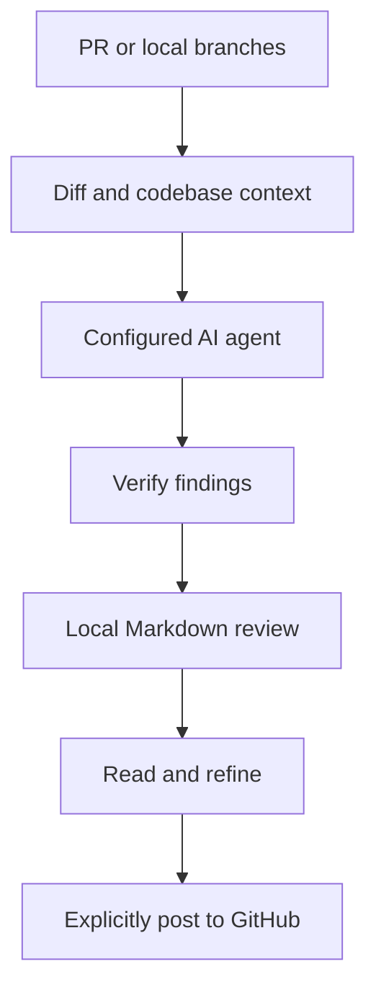

# Overview

prr brings AI code review to your terminal. Review a GitHub pull request or compare local branches, then read structured Markdown findings before deciding what to post.

## How a review works

prr resolves your target, gathers the diff and nearby code, asks your chosen agent for a review, and verifies findings against the source. Results are written to local files. Posting to GitHub is a separate, explicit command.

## Choose your next step

- [Installation](installation.md): install and run your first review.
- [Reviewing changes](reviews.md): PRs, branches, focused reviews and verification.
- [Agents](agents.md): use CLI sessions or API credentials.
- [Configuration](configuration.md): defaults, filters and project rules.
- [Review output](output.md): inspect, compare, browse and post findings.
- [Command reference](commands.md): commands and useful flags.
- [Development](development.md): Flox, Bun, checks and releases.
- [Troubleshooting](troubleshooting.md): diagnose common setup problems.

## What stays local

Review files are stored on your machine. The selected AI provider receives the diff and supplied context; this is not an offline review engine. Use an agent and account appropriate for your repository. prr does not publish review comments until you run `prr post`.

## What you need

Use Git for local branch reviews and an authenticated GitHub CLI for PR reviews. Configure at least one supported AI agent. The default is the locally installed Claude CLI. Verification is enabled by default, but AI findings still need your judgment.
