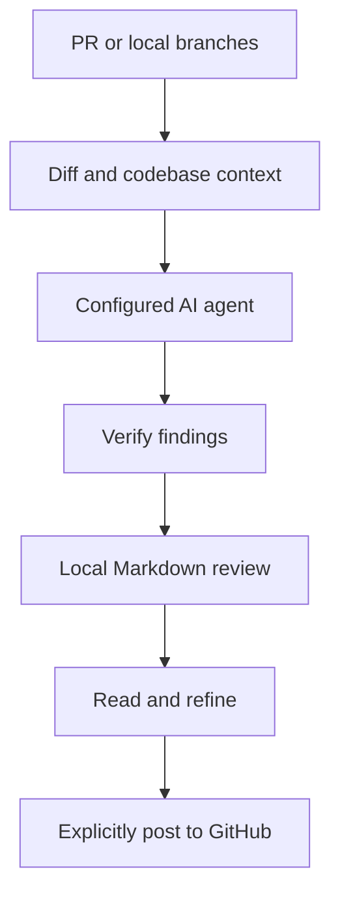

# Overview

prr brings AI code review to your terminal. Review a GitHub pull request or compare local branches, then read structured Markdown findings before deciding what to post.

## How a review works

prr resolves your target, gathers the diff and nearby code, asks your chosen agent for a review, and verifies findings against the source. Results are written to local files. Posting to GitHub is a separate, explicit command.

## Choose your next step

- [Installation](installation.md): install and run your first review.
- [Reviewing changes](reviews.md): PRs, branches, focused reviews and verification.
- [Agents](agents.md): use CLI sessions or API credentials.
- [Configuration](configuration.md): defaults, filters and project rules.
- [Review output](output.md): inspect, compare, browse and post findings.
- [Command reference](commands.md): commands and useful flags.
- [Development](development.md): Flox, Bun, checks and releases.
- [Troubleshooting](troubleshooting.md): diagnose common setup problems.

## What stays local

Review files are stored on your machine. The selected AI provider receives the diff and supplied context; this is not an offline review engine. Use an agent and account appropriate for your repository. prr does not publish review comments until you run `prr post`.

## What you need

Use Git for local branch reviews and an authenticated GitHub CLI for PR reviews. Configure at least one supported AI agent. The default is the locally installed Claude CLI. Verification is enabled by default, but AI findings still need your judgment.

## A practical review loop

Start with one pull request and one agent. Read the summary, check the cited code, and decide which findings are actionable. After changing the code, run another review and compare the saved directories. You control when a local result becomes a GitHub review.

| Your goal | Start with | What you get |
| --- | --- | --- |
| Review an existing PR | `prr 123` | Findings tied to GitHub PR metadata |
| Review before opening a PR | `prr --base main` | A local comparison of committed branches |
| Inspect saved findings | `prr serve --open` | A browser for your local review files |
| Ask about a finding | `prr ask "Which input triggers this?"` | A follow-up answer using saved review context |
| Share a review | `prr post --dry-run` | A preview of the GitHub payload |

Replace `main` with your repository's base branch. Review commands generate suggestions; they do not replace your test suite or prove that a change is correct. Verification is another model pass against the available evidence, so read the resulting findings before acting on them.

## Review data and boundaries

The diff, selected context, and project review rules form the input to your chosen integration. A CLI provider can still communicate with its remote model service. Saved findings remain on disk until you remove them, and they may contain excerpts of private source code.

Use [configuration](configuration.md) to control context and ignored paths, and [review output](output.md) to understand storage and posting. Disabling extra context does not make a review offline or prevent the diff itself from reaching the provider.
