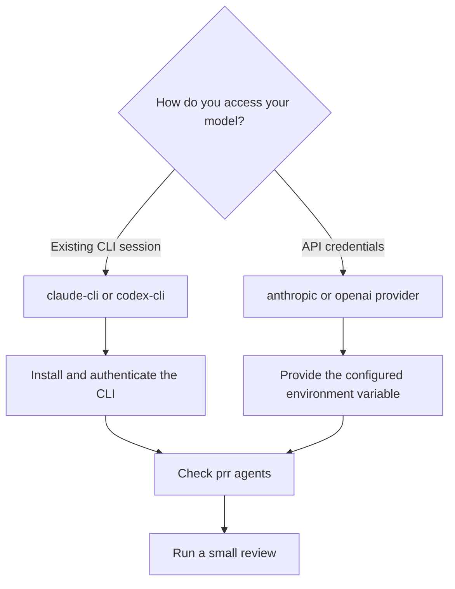

# Agents

prr supports local CLI agents and direct API providers. Agent names are configuration keys, while providers identify the integration.

## Built-in agents

| Agent name | Provider | Authentication |
| --- | --- | --- |
| `claude-cli` | `claude-cli` | Installed and authenticated Claude CLI |
| `codex-cli` | `codex-cli` | Installed and authenticated Codex CLI |
| `claude-api` | `anthropic` | `ANTHROPIC_API_KEY` |
| `gpt-api` | `openai` | `OPENAI_API_KEY` |

The default is `claude-cli`. Run `prr agents` to see your configured agents and availability.

## Select an agent

```sh
prr 123 --agent claude-cli
prr 123 --agent codex-cli
prr 123 --agent claude-api
prr 123 --agent gpt-api
```

CLI integrations use existing CLI sessions. API integrations require the environment variable named in `api_key_env`. Never put API keys in committed configuration files.

## Customize a model

Edit `~/.config/prr/config.yaml`:

```yaml
default_agent: claude-cli
agents:
  claude-cli:
    provider: claude-cli
    model: opus
  my-api-agent:
    provider: openai
    model: your-available-model
    api_key_env: OPENAI_API_KEY
    max_tokens: 8192
```

Choose a model available to your provider account. Model access, capabilities and pricing are controlled by the provider.

## Separate review and verification

```sh
prr 123 --agent claude-cli --verify-agent codex-cli
```

Without an override, verification uses the review agent. Both integrations must be available when you choose different agents.

## Choose an integration

Use a CLI integration when you already work with an authenticated Claude or Codex installation. Choose an API integration when you want prr to call the provider API directly using a key supplied by your shell or secret manager.



Agent names are yours to choose. In the example above, `my-api-agent` is the name you pass to `--agent`, while `openai` selects the provider implementation. Changing a name does not change authentication or the provider's capabilities.

## Diagnose availability before a large review

For a CLI agent, check that the executable is visible in the same shell where you run prr. Authentication in a different machine, container, or shell environment may not be available to that process.

```sh
command -v claude
command -v codex
prr agents
```

For an API agent, confirm that `api_key_env` names the variable your environment actually exports. Do not print the value in logs. A configured variable can still contain an expired key, and a valid key does not guarantee access to the selected model.

The built-in API model names are defaults, not a live catalog. Update `model` to an identifier available to your account if a provider rejects it. See [troubleshooting](troubleshooting.md) when a listed agent fails during generation.

## Balance review depth and usage

A review and its verification pass can each make model requests. `--all` adds multiple configured agents, which can increase latency and provider usage. Start with one agent, then add another perspective when the change warrants it.

Separate review and verification agents can provide different perspectives, but they still operate on the evidence prr supplies. Keep human review and tests in the loop even when both agents agree.
