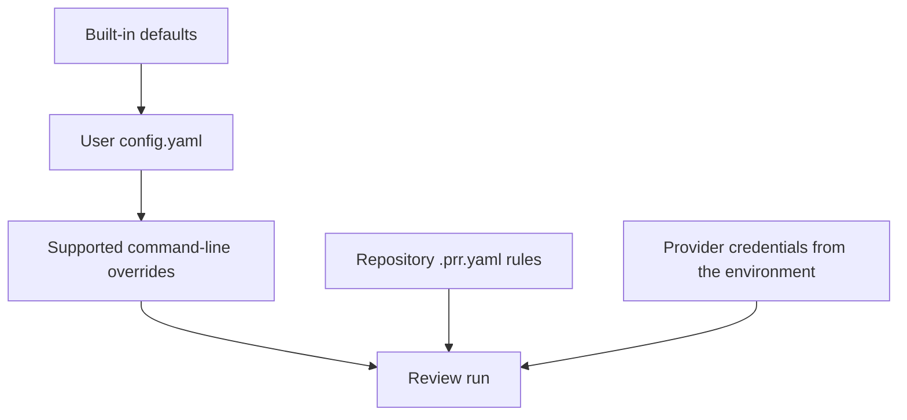

# Configuration

prr reads `~/.config/prr/config.yaml`. If the file is missing, built-in defaults apply.

## Initialize configuration

```sh
prr config init
```

Edit the generated file to customize your agents, review scope, verification and output location.

## Review defaults

```yaml
default_agent: claude-cli
review:
  max_diff_lines: 10000
  codebase_context: true
  max_context_lines: 2000
  verify: true
  verify_action: drop
  ignore_patterns:
    - "*.lock"
    - "go.sum"
    - "vendor/**"
    - "node_modules/**"
  severity_levels:
    - critical
    - suggestion
    - nit
    - praise
output:
  severities:
    - critical
    - suggestion
```

The ignore list above is an example subset; the generated defaults also omit common generated and minified files. CLI flags can override review behavior for a single run.

## Output location

The default is `$XDG_DATA_HOME/prr/reviews` when `XDG_DATA_HOME` is set, otherwise `~/.local/share/prr/reviews`. Set `output.dir` in configuration or pass `--output-dir` to change it.

## Project-specific rules

Add `.prr.yaml` to the repository to provide additional review instructions:

```yaml
rules:
  - "Check error handling at API boundaries."
  - "Prefer existing repository helpers over new abstractions."
```

The supported project schema is a `rules` list of strings. Keep rules focused on conventions that a reviewer cannot infer from the changed code.

## Credentials

Use environment variables for API keys. CLI agents manage authentication themselves. A configuration file names the environment variable, not its secret value. See [agents](agents.md) for provider setup.

## How settings fit together

The user configuration starts from built-in defaults. Values provided in `config.yaml` customize that configuration; command-line flags override supported options for the current invocation. Repository `.prr.yaml` files contribute review instructions rather than replacing the user configuration.



A `.prr.yaml` file is therefore the place for team review conventions, not API credentials or a different global output directory. Put agent definitions in the user configuration and keep secrets in the environment.

## Scope and output settings

| Setting | Default | Effect |
| --- | --- | --- |
| `review.max_diff_lines` | `10000` | Warns when a diff is large; it does not truncate the diff |
| `review.codebase_context` | `true` | Includes nearby code to explain existing patterns |
| `review.max_context_lines` | `2000` | Limits the additional codebase context |
| `review.verify` | `true` | Checks generated findings against source evidence |
| `review.verify_action` | `drop` | Omits findings marked inaccurate; `annotate` preserves them with notes |
| `output.severities` | All four levels | Filters which severity levels are kept in output |

The earlier YAML example narrows output to critical findings and suggestions; that is an example customization, not the built-in severity default. Narrowing output does not mean that omitted issues cannot exist.

Ignore patterns support filename matching such as `*.lock` and directory patterns such as `vendor/**`. If files appear to be missing, inspect the reported filtered-file count and your ignore list before changing the model. Keep generated files out of reviews only when that matches your intended scope.

## Keep separate review folders

An output override is useful for comparing experiments without mixing them with normal reviews:

```sh
prr 123 --output-dir ./review-experiment
prr history --output-dir ./review-experiment
prr serve --output-dir ./review-experiment --open
```

Use the same override on later commands so they look in the same location. Avoid committing a review directory accidentally: findings can contain repository code and private PR details.
