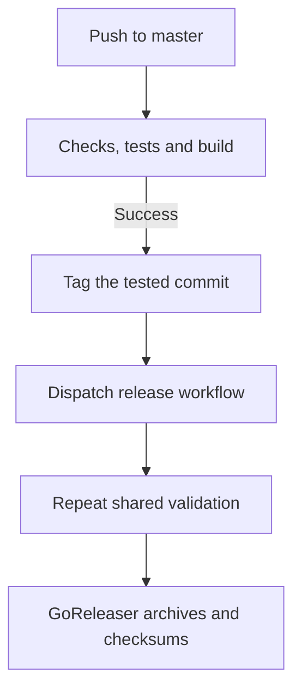
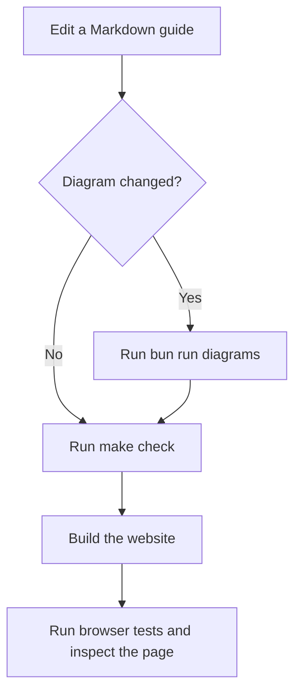

# Development

Flox supplies the shared Go, Bun, Git, GitHub CLI and pre-commit environment. Bun manages website and validation dependencies; the CLI remains a standalone Go binary.

## Set up

```sh
flox activate
make setup
```

Setup installs dependencies from the Bun lockfiles and installs pre-commit hooks. Keep API credentials in your shell or credential manager, never in the Flox manifest.

## Run the website

```sh
flox activate --start-services
```

The website service listens on `http://localhost:3004`. Alternatively, run `bun run --cwd website dev`. Documentation pages are generated from the Markdown files in `docs/`; edit those files rather than duplicating page content.

## Shared checks

```sh
make check
make test
make website
pre-commit run --all-files
```

`make check` checks Go formatting and vet, workflow syntax, Markdown style, local documentation links, Mermaid syntax, the website type checker and linter, and authored source line budgets. The pre-commit hook runs the same checks. `make test` runs Go race tests and checks the 79% coverage floor; pre-push runs tests, the production website build, browser checks, and release cross-compilation, matching CI.

## Keep the implementation lean

New website TypeScript files are limited to 220 lines; authored website code is limited to 2,500 lines. Documentation and generated lockfiles do not count toward code budgets. Extend shared components and keep Markdown as the single content source. Existing Go source is tracked against its baseline; avoid growing unrelated runtime code for tooling changes.

## Release flow



Automatic releases use the next patch version, or `v0.1.0` when no release exists. Only successful push CI on the default branch can trigger a release. The release workflow accepts a tag and checks out that tag. Homebrew publishing requires the repository's tap token; see the release configuration before enabling distribution to a separate repository.

## Diagrams and deployment

Mermaid sources live in the Markdown documents. Their SVG previews are generated at development time, so readers do not download a diagram engine. After changing a diagram, run:

```sh
bunx playwright install chromium
bun run diagrams
```

CI validates Mermaid syntax and checks that each SVG matches its source hash. Browser checks use Playwright Chromium and axe; run `bun run test:website` after building the site. Set `SITE_URL` to the production origin when deploying to enable canonical social URLs, sitemap entries and indexing. Without it, robots disallows crawling.

## Website verification

Use the Maestri portal or your browser to inspect `/`, `/docs`, narrow-screen navigation, search, code copying and unknown routes. Run the production build before delivery. Brand assets live in `website/public`; the README shares copies in `assets/`.

## Editing documentation

Add explanations and examples to the relevant guide in `docs/`. Use a language on each fenced block: `sh` for commands, `yaml` for configuration, `text` for output, and `mermaid` for diagrams. Code highlighting is generated during the site build; the Copy button copies the original code text without language labels or markup.



Keep diagrams focused on a decision or sequence that benefits from a visual explanation. Follow each diagram with prose so readers can understand the workflow from the Markdown source or without interpreting the image. Commit the generated SVG alongside its source change.

## Reproduce a release build

```sh
make release-check
```

This creates snapshot binaries for macOS and Linux on Intel and ARM without publishing a release. GoReleaser disables CGO for these portable binaries; normal race tests retain their own build settings. The cross-compilation check runs in CI and the pre-push hook, and `make ci` includes it with the full validation suite.

If a check fails, fix the first reported error and rerun the relevant command before running the complete suite. Do not raise the LOC ceiling to hide duplicate components or CSS; prefer shared rendering and remove rules that are already overridden.
