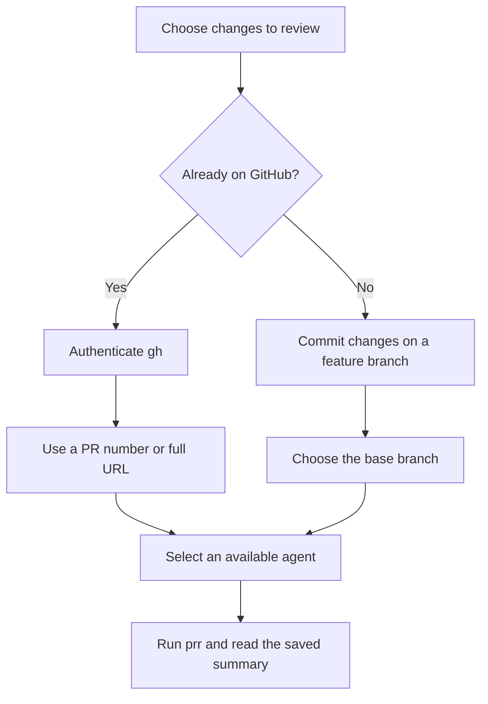

# Installation

Install the CLI, authenticate your tools, and run a review from a Git repository.

## Install with Go

Use the Go version declared in [go.mod](../go.mod) or newer.

```sh
go install github.com/smeltery/prr@latest
```

Ensure `$(go env GOPATH)/bin` is on your `PATH`. Alternatively, download the matching macOS or Linux archive from [GitHub releases](https://github.com/smeltery/prr/releases), verify it against `checksums.txt`, and place the binary in a directory on your `PATH`.

## Authenticate your tools

For GitHub pull requests, install [GitHub CLI](https://cli.github.com/) and sign in:

```sh
gh auth login
gh auth status
```

The default agent is `claude-cli`. Install and authenticate the Claude CLI separately, or configure another [agent](agents.md). CLI providers use their own authentication; API providers read credentials from environment variables.

## Run your first review

```sh
prr config init
prr agents
prr
```

Run `prr` inside a repository with a PR on the current branch, or supply a PR URL:

```sh
prr https://github.com/owner/repo/pull/123
```

Read the output directory printed by the command. Use `prr serve --open` to browse results. Nothing is posted automatically.

## Build from source with Flox

```sh
git clone https://github.com/smeltery/prr.git
cd prr
flox activate
make install
```

See [development](development.md) for the shared toolchain and checks.

## Check the installation

Open a new terminal after changing your shell configuration. Confirm that the binary resolves and that prr can discover your agents:

```sh
command -v prr
prr --help
prr agents
```

If `go install` succeeds but `prr` is not found, check whether you set `GOBIN`. Otherwise Go installs binaries under `$(go env GOPATH)/bin`. For the default location, add this to your shell configuration and reload the shell:

```sh
export PATH="$(go env GOPATH)/bin:$PATH"
```

A listed agent is a starting point, not proof that its remote account or model is usable. Run a small review to confirm authentication and model access end to end.

## Choose your first target



For a PR number, run inside the matching repository. A full URL identifies the repository explicitly and works outside a checkout. For a local review, use `--base` and ensure both branches exist locally; uncommitted working-tree edits are not the branch comparison.

```sh
# Review the current feature branch against your base branch.
prr --base main --agent codex-cli
```

If your base branch is named `master`, substitute that name. See [reviewing changes](reviews.md) for selecting a repository or a different head branch.

## Updating prr

Repeat the Go installation command to install the latest tagged version, or download a newer release archive for the same operating system and architecture. Apple Silicon and Linux ARM machines use `arm64`; Intel and AMD machines use `amd64`.

Updating the binary does not require overwriting your configuration. `prr config init` refuses to replace an existing file unless you pass `--force`; keep your customized agents and output settings when upgrading.
