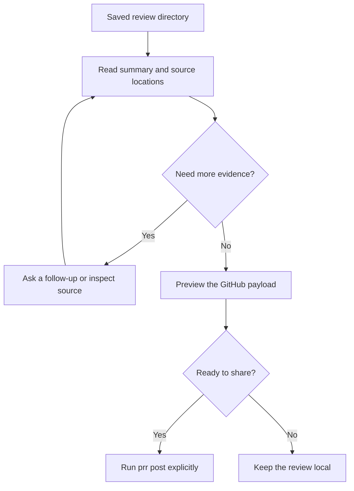

# Review output

Each review produces a local directory with a summary, metadata, and findings organized by severity and source file.

## Read findings

```text
~/.local/share/prr/reviews/
  pr-123-20261018-143000/
    summary.md
    critical/
      src-auth-handler-go.md
    suggestion/
      src-middleware-session-go.md
```

Severity levels are `critical`, `suggestion`, `nit`, and `praise`. Only directories with findings are created. Local reviews use a `review-<base>-vs-<head>-<timestamp>` directory name.

## Browse locally

```sh
prr serve --open
prr serve --port 9000
```

The embedded review browser provides search, severity filters, file navigation and Markdown copy controls. It is separate from this documentation website and requires no JavaScript runtime to serve.

## Ask and compare

```sh
prr ask "Is this race condition exploitable?"
prr diff /path/to/first-review /path/to/second-review
prr history
```

Use follow-up questions to inspect the review's reasoning and compare runs after changing the code.

## Post deliberately

```sh
prr post --dry-run
prr post
prr post /path/to/review --event comment
```

Without a directory, posting selects the latest PR review. Preview the payload first. Only reviews with GitHub PR metadata can be posted; the GitHub CLI needs write access. `--event request_changes` explicitly requests changes.

## Clean old reviews

```sh
prr clean --days 30 --dry-run
prr clean --days 30
```

The second command deletes matching local review directories. Review the dry-run output before removing results you want to keep.

## From findings to a shared review



Start with `summary.md` to understand the review as a whole, then open the severity directories for file-level comments. Critical findings deserve attention first, but severity is an agent assessment rather than a guarantee about impact.

A saved review is a snapshot of the inputs available during that run. It does not update when the branch changes. Rerun the review after modifying code, and keep the earlier directory if you want to compare results.

## Target a specific saved review

Explicit paths avoid ambiguity when you have reviewed several PRs or used multiple output directories:

```sh
prr ask "What input triggers this finding?" /path/to/review
prr post /path/to/review --dry-run
prr post /path/to/review --event comment
```

Without an explicit path, `ask` prefers the latest PR review and falls back to another saved review if no PR review exists. `post` requires a PR review. Supplying a path is the clearest way to continue work on an older run.

The preview command does not submit a GitHub review. Inspect the target PR, comments, and event before running the posting command. Keep the metadata with the review directory so prr can identify its PR; a local branch review cannot acquire a GitHub target merely by renaming its folder.

## Run the review browser

`prr serve` uses port `8600` by default and stays running until you press Ctrl+C. `--open` asks your operating system to open the browser; if it does not, visit the URL printed in the terminal. Choose another port when that port is already occupied.

The server binds to all network interfaces. Use it in an environment where exposing review contents on that port is appropriate; it is a review viewer, not an authenticated hosting service.

## Retention and cleanup

Run `prr history` to find saved directories before cleaning them. The dry run shows what would be removed; the matching cleanup command deletes those directories. Copy any review you need to preserve before deletion, especially if it records an investigation you may revisit.
