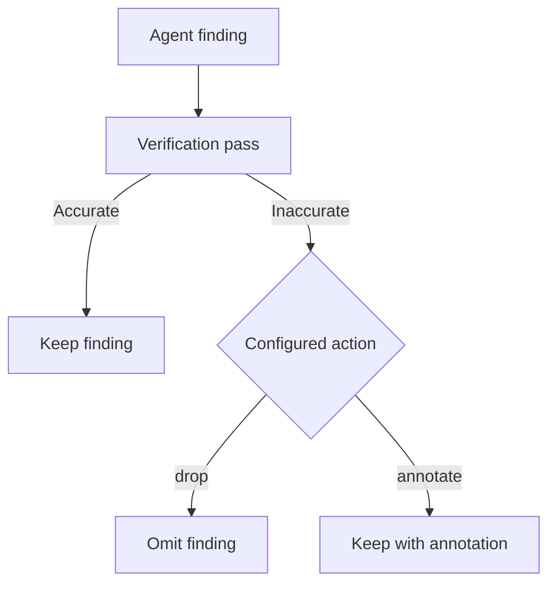

# Reviewing changes

Choose a pull request or local branches, then control the scope and verification of the review.

## GitHub pull requests

```sh
prr                         # Current branch's PR
prr 123                     # PR in the current repository
prr https://github.com/owner/repo/pull/123
```

URL mode fetches the PR remotely with `gh`; it does not require a local clone. Repository access follows your GitHub CLI credentials.

## Local branches

```sh
prr --base main
prr --repo /path/to/repo --base main --head feature/auth
```

Local mode compares branches with Git and does not need a GitHub PR. Local-only reviews cannot be posted with `prr post`.

## Focus and context

```sh
prr 123 --focus security,performance
prr 123 --no-context
```

Codebase context includes nearby files to help the agent follow existing patterns. `--no-context` disables that additional context. Ignore patterns and maximum diff size are configurable in [configuration](configuration.md).

## Verification

Verification is enabled by default. Each finding is checked against the diff and source; inaccurate findings are dropped by default. Annotate instead to keep disputed findings visible.

```sh
prr 123 --verify-action annotate
prr 123 --verify-agent codex-cli
prr 123 --no-verify
```



## Multiple perspectives

```sh
prr 123 --agent codex-cli
prr 123 --all
```

`--all` runs configured agents. Check availability with `prr agents` first; providers may require different credentials and may incur usage charges.

## Incremental review limitation

The CLI currently accepts `--since`, but does not apply it to the review pipeline. Review the full diff or select a narrower local base branch instead.
