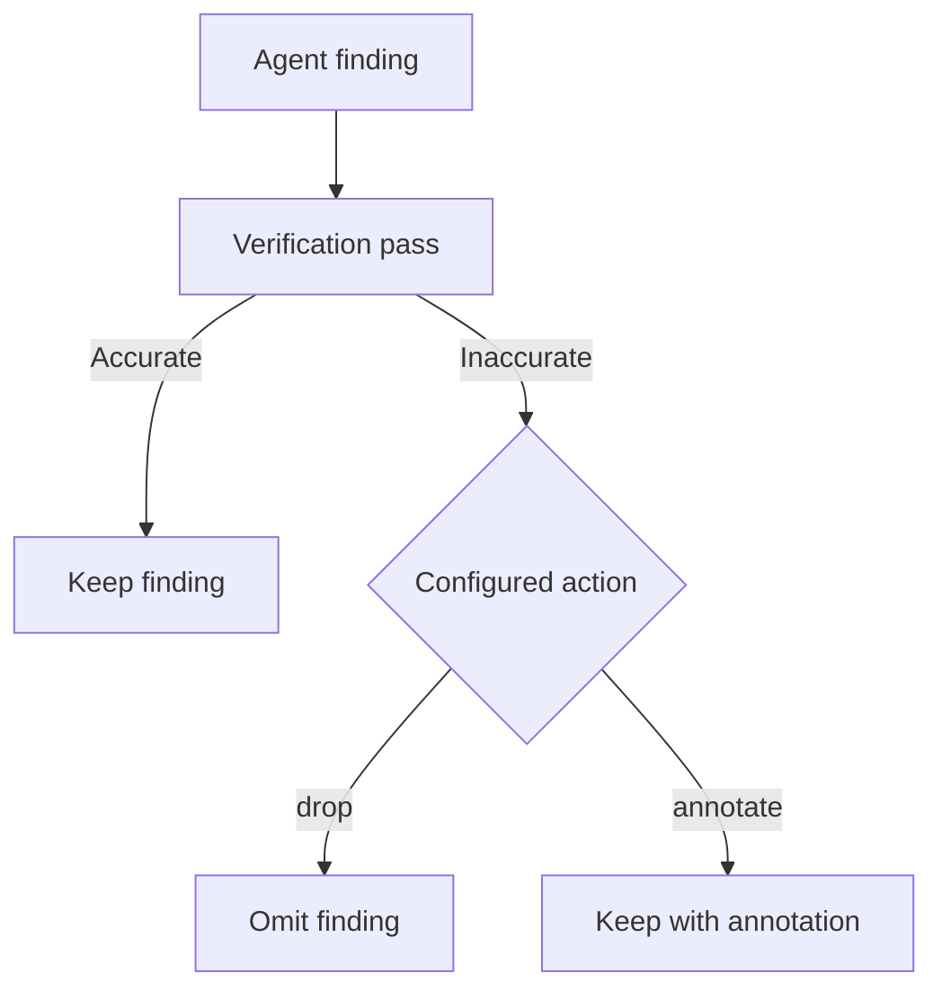

# Reviewing changes

Choose a pull request or local branches, then control the scope and verification of the review.

## GitHub pull requests

```sh
prr                         # Current branch's PR
prr 123                     # PR in the current repository
prr https://github.com/owner/repo/pull/123
```

URL mode fetches the PR remotely with `gh`; it does not require a local clone. Repository access follows your GitHub CLI credentials.

## Local branches

```sh
prr --base main
prr --repo /path/to/repo --base main --head feature/auth
```

Local mode compares branches with Git and does not need a GitHub PR. Local-only reviews cannot be posted with `prr post`.

## Focus and context

```sh
prr 123 --focus security,performance
prr 123 --no-context
```

Codebase context includes nearby files to help the agent follow existing patterns. `--no-context` disables that additional context. Ignore patterns and maximum diff size are configurable in [configuration](configuration.md).

## Verification

Verification is enabled by default. Each finding is checked against the diff and source; inaccurate findings are dropped by default. Annotate instead to keep disputed findings visible.

```sh
prr 123 --verify-action annotate
prr 123 --verify-agent codex-cli
prr 123 --no-verify
```



## Multiple perspectives

```sh
prr 123 --agent codex-cli
prr 123 --all
```

`--all` runs configured agents. Check availability with `prr agents` first; providers may require different credentials and may incur usage charges.

## Incremental review limitation

The CLI currently accepts `--since`, but does not apply it to the review pipeline. Review the full diff or select a narrower local base branch instead.

## Select the comparison deliberately

A PR review uses the PR's base and head information. A local review uses a three-dot Git diff (`base...head`), showing changes on the head since it diverged from the base in the selected repository; `--head` defaults to the current branch. Supplying `--repo` or `--base` selects local mode. Use a feature branch distinct from the base, because comparing a branch to itself produces nothing to review.

```sh
# Check that both refs exist before requesting a local review.
git rev-parse --verify main
git rev-parse --verify feature/auth
prr --base main --head feature/auth
```

Commit the changes you want included in the branch comparison. If the required base is only available remotely, fetch it and select the appropriate ref. prr does not turn uncommitted edits into a commit for you.

## Read the scope before the findings

The command reports the selected target and how many files remain after filtering. Check those messages first: the wrong base or an overly broad ignore rule can make a plausible-looking review answer the wrong question.

A large-diff warning is advisory; `max_diff_lines` does not automatically truncate the input. Smaller, cohesive changes are easier to review. `--focus` supplies review priorities, while `--no-context` removes additional codebase context; neither flag is a substitute for choosing the right diff.

## Investigate a disputed finding

Keep annotations while diagnosing verification disagreements, then inspect the saved output:

```sh
prr 123 --verify-action annotate --min-severity suggestion
prr serve --open
```

`--min-severity suggestion` keeps critical findings and suggestions while excluding nits and praise. Check the source location and the conditions described by the finding. Use a follow-up question to ask for the failing input or execution path, then reproduce the problem with a test when practical.

## After the code changes

Run a fresh review after making a fix. Saved directories let you compare the earlier and later results with `prr diff`. This compares review output, not a proof that the underlying bug was fixed. Verify the actual behavior with your project's tests and read the revised diff before posting.
