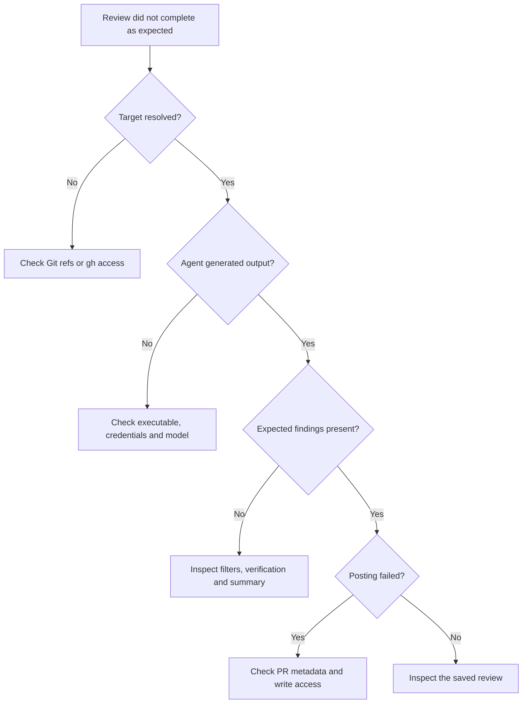

# Troubleshooting

Start by checking the command's error and the availability of the external tools it uses.

## Agent unavailable

Run `prr agents`. For CLI providers, check that the corresponding binary is on `PATH` and authenticated. For API providers, check the environment variable named in the agent configuration and confirm access to the selected model. Do not paste credentials into issue reports.

## Pull request cannot be resolved

Run `gh auth status`, verify repository access, and confirm that your current branch has a PR. Supply a full PR URL when you are outside a checkout or want to target another repository.

## Local comparison fails

Check the repository path and branch names with Git. Both base and head must resolve in the selected repository. Fetch the required branches before retrying.

## No findings or missing files

Inspect `summary.md` first. Check ignore patterns, severity filters, maximum diff size, and verification settings. A clean review can have no findings. To inspect disputed comments, rerun with `--verify-action annotate`.

## Posting fails

Use `prr post --dry-run` to inspect the payload. Check that the directory contains a PR review with metadata and that your GitHub account can submit a review. Local branch reviews cannot be posted directly.

## Website or hooks fail

Activate Flox, then run `make setup` again to install the locked dependencies. Check that port 3004 is available. Use `make check` to reproduce the CI checks and read the first failing command.

## Report a problem

Open a [GitHub issue](https://github.com/smeltery/prr/issues) with your prr version, operating system, command, and redacted error output. Exclude API keys, private source code and review contents unless you intend to share them.

## Follow the failing stage



Work from the earliest failed stage. Changing severity filters cannot fix repository authentication, and reinstalling prr will not grant access to a provider model. Keep the exact error message while checking one cause at a time.

## Binary not found after installation

```sh
command -v prr
go env GOBIN GOPATH
```

If `GOBIN` is empty, check the `bin` directory under `GOPATH`. Ensure that installation directory is on the current shell's `PATH`. A new terminal may be necessary after editing your shell configuration. See [installation](installation.md) for the default-path example.

## Large or truncated reviews

A large-diff warning means the input may be difficult to review thoroughly; it is not a hard cutoff. A truncated agent response means some generated output may be missing. Try a smaller branch comparison, inspect ignore patterns, or adjust the configured provider's response token budget where supported. A focus prompt can guide attention but does not remove files from the input.

## Review browser is empty

Check the directory printed by `prr serve` and compare it with the location printed by your review command. If you used `--output-dir` when generating the review, use the same override for the browser and history commands:

```sh
prr history --output-dir ./review-experiment
prr serve --output-dir ./review-experiment --open
```

If history also shows no reviews, confirm that a review completed and wrote output there. If the port is occupied, retry with `--port 9000`. Stop the server with Ctrl+C when finished.
